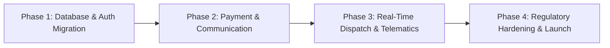

# 15 — Recommended Implementation Priorities & Strategic Roadmap

This document outlines the recommended sequencing of development phases following this audit, establishing a clear roadmap from current state to commercial healthcare deployment.

---

## 1. Phased Implementation Roadmap

---

## 2. Phase-by-Phase Execution Plan

### Phase 1: Database & Authentication Hardening (Weeks 1–2) — *P0 Critical*
1. **PostgreSQL Database Provisioning:**
   - Deploy a managed PostgreSQL instance (Supabase or AWS RDS).
   - Execute `npx prisma db push` using the existing declarative schema in `prisma/schema.prisma`.
   - Replace in-memory array methods in `src/lib/db.ts` with Prisma Client queries (`prisma.booking.findMany(...)`).
2. **Enterprise Authentication Integration:**
   - Integrate NextAuth.js (Auth.js v5) or Supabase Auth.
   - Connect Twilio Verify API for production SMS OTP delivery.
   - Enforce HTTP-only, secure, SameSite session cookies and role-based route middleware.

### Phase 2: Live Payment & Communication Gateways (Weeks 3–4) — *P1 High*
1. **Payment Gateway Integration:**
   - Embed Stripe Elements on Step 4 of `/patient/book`.
   - Create Next.js API route `/api/checkout` to create Stripe PaymentIntents.
   - Deploy `/api/webhooks/stripe` to handle asynchronous payment confirmation and update booking status to `CONFIRMED`.
2. **Automated Notification Engine:**
   - Configure SendGrid or Resend for appointment confirmation emails and digital lab PDF delivery.
   - Configure Twilio SMS notifications for live clinician arrival alerts.

### Phase 3: Real-Time Telematics & Interactive Maps (Weeks 5–6) — *P2 Moderate*
1. **Interactive Fleet Maps:**
   - Replace stylized tracking cards with Mapbox GL JS on `/patient/bookings/[id]` and `/admin/dispatch`.
   - Render real-time route polyline from clinician starting point to patient home.
2. **WebSocket Fleet Telemetry:**
   - Integrate Pusher or Supabase Realtime channels (`booking:{id}`) to broadcast clinician GPS coordinates every 10 seconds.

### Phase 4: Compliance Hardening & Mobile Optimization (Weeks 7–8) — *Enterprise Ready*
1. **HIPAA / GDPR Compliance Checklist:**
   - Implement database encryption at rest (AES-256) and TLS 1.3 in transit.
   - Configure automated access logging in the `AuditLog` table for every clinician EMR interaction.
   - Implement Business Associate Agreement (BAA) safeguards on all cloud vendors.
2. **PWA Mobile Packaging:**
   - Add Web App Manifest and Service Worker for offline patient record access and emergency offline phone dialing.

---
*Report generated for technical reviewer evaluation.*
